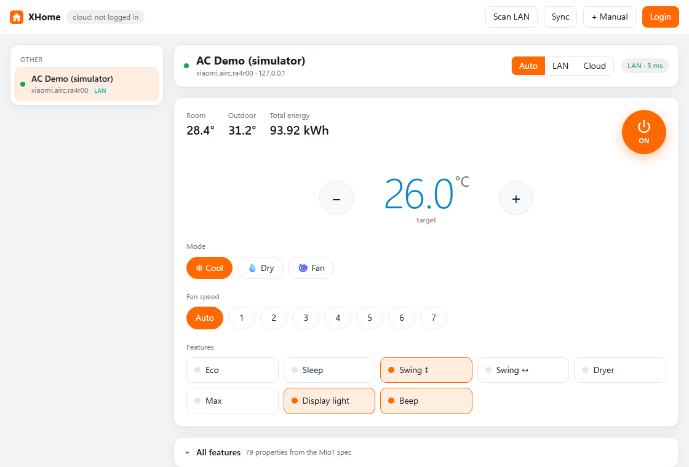

# XHome — Xiaomi Home on your laptop (LAN + Cloud)

A reverse-engineered client for the **Xiaomi Home / Mi Home** app, packaged as a Windows desktop app and a
CLI. Devices can be controlled over **two paths**:

* **Local (LAN):** the miIO protocol straight to the device (UDP 54321). Fast, and works without internet.
* **Cloud (API server):** the private API used by the Xiaomi Home app (`*.api.io.mi.com`). Works from
  anywhere, including for BLE/Zigbee devices.

The default `auto` mode tries the LAN first and falls back to the cloud automatically. Protocol details are
in [docs/PROTOCOL.md](docs/PROTOCOL.md).



## Desktop app

The app runs in its own window (WebView2), with no console and no browser:

* **AC remote:** power button, target temperature with +/−, mode, fan speed, and Eco/Sleep/Swing/... toggles.
* **Live status:** refreshed every 5 seconds.
* **Connection path:** Auto / LAN / Cloud. Auto tries the LAN first. If the LAN is unreachable (e.g. the
  laptop is away from home) it switches to the cloud in about 2 seconds and keeps using the cloud for 60 s.
* **All features:** every property from the device's MIoT spec, plus a raw miIO console.

Build it and install it to `%LOCALAPPDATA%\Programs\XHome` with Desktop and Start Menu shortcuts:
```bash
python tools/build_app.py --install
```
To run the same app without building an `.exe`, use `python -m xhome app`.

## Installation

```bash
pip install -r requirements.txt
```
Building the `.exe` also needs `pip install pyinstaller`.

## Quick start

```bash
python -m xhome login --browser
```
This opens Xiaomi's official login page in your browser. Sign in there with your Xiaomi Home account; the
device list, including each device's **LAN token** and IP, is synced automatically.

Without `--browser`, a login QR code opens instead. Scan it with your **phone camera / Google Lens**, open
the link, then sign in and confirm. Do not use the "Add device" scanner in the Xiaomi Home app: it only
understands device QR codes and answers "device not found".

```bash
python -m xhome devices
```
```bash
python -m xhome app
```

## CLI commands

| Command | What it does |
|---|---|
| `login [--browser] [--password] [--server sg]` | log in (QR by default, `--browser` = Xiaomi's login page). Southeast Asian accounts are usually on `sg` |
| `servers [--use X]` | count devices on every region, switch the active region |
| `devices [--refresh] [--all-servers] [--tokens] [--json]` | list devices (tokens only with `--tokens`) |
| `discover` | scan the local network for miIO devices |
| `add <ip> <token> [--name N]` | add a LAN device manually, without the cloud |
| `spec <device\|model>` | every feature of a device (properties & actions) |
| `get <device> [key…] [--via]` | read state |
| `set <device> <key> <value> [--via]` | change state |
| `action <device> <action> [arg…]` | run an action (toggle, start-sweep, ...) |
| `raw <device> <method> [json]` | raw miIO command |
| `watch <device> [key…]` | watch state changes live |
| `info <device>` / `token <device>` | firmware info / show the LAN token |
| `app` | desktop app (own window) |
| `serve` | the same UI in a browser (http://127.0.0.1:8765) |

`<device>` can be a (partial) name, room, did, IP, or a short alias such as `ac`, `light`, `plug`.
`--via` is `auto` / `local` / `cloud`. Property keys can be names (`light.on`, `brightness`) or
`siid.piid` (`2.1`).

Examples:
```bash
python -m xhome spec ac
```
```bash
python -m xhome set ac air-conditioner.on on
```
```bash
python -m xhome set ac target-temperature 26 --via cloud
```
```bash
python -m xhome watch ac temperature target-temperature --interval 2
```

## LAN or cloud?

| Device type | LAN | Cloud |
|---|---|---|
| Wi-Fi (lights, plugs, purifiers, vacuums, cameras, ACs…) | ✅ when the laptop is on the same network | ✅ |
| Bluetooth / BLE Mesh (temperature sensors, ...) | ❌ | ✅ through a gateway/hub |
| Zigbee (Aqara, gateway sub-devices) | ❌ | ✅ |

## Security

* **Credentials never live in the project folder.** The account session (`session.json`: `ssecurity`,
  `serviceToken`, `passToken`) and the LAN tokens (`devices.json`) are stored in `%LOCALAPPDATA%\XHome`
  (override with `XHOME_DATA`), shared by the CLI and the desktop app. `.gitignore` also excludes `data/`,
  `build/` and `dist/` as a second line of defence.
* LAN tokens are only printed when explicitly requested (`token`, `devices --tokens`).
* Run `python -m xhome logout` to remove the cloud session. To revoke it on Xiaomi's side as well, sign out
  of other devices in your Xiaomi account settings.
* The local UI only listens on `127.0.0.1`, rejects foreign `Host` headers (DNS rebinding) and rejects
  write requests without the `X-XHome` header (CSRF).
* A device's LAN token changes when it is reset or re-paired; run `devices --refresh` afterwards.

## Troubleshooting

* **0 devices after login:** wrong server region. Run `python -m xhome servers`, then `--use <server>`.
* **LAN timeouts:** the laptop must be on the same subnet as the device. Run `discover` (IPs changed by DHCP
  are updated automatically) and allow Python / XHome in Windows Firewall for Private networks.
* **Password login asks for a captcha or 2FA:** use `login --browser` or the QR login instead.

## Testing without devices

```bash
python tests/test_offline.py
```
```bash
python tests/demo_server.py --ac
```
`test_offline.py` tests the crypto and the LAN protocol against a fake miIO device.
`demo_server.py` serves the UI on http://127.0.0.1:8766 backed by that simulator (a Yeelight bulb, or the
Mijia AC with `--ac`). The simulator's token is a fixed dummy value.

## Layout

```
xhome/
  crypto.py   RC4 + cloud request signing, miIO AES
  cloud.py    QR/browser/password login, session refresh, encrypted API, device list, MIoT over cloud
  local.py    miIO UDP protocol: discovery, handshake, encryption, MIoT over LAN
  spec.py     MIoT-Spec download & cache, feature names <-> siid/piid, value conversion
  hub.py      one device list, auto/local/cloud routing
  cli.py      `python -m xhome ...` commands
  web.py      FastAPI backend for the UI
  desktop.py  desktop window (pywebview / WebView2)
  static/     UI (AC remote + all features) and icon
app.py        XHome.exe entry point
tools/        build_app.py (PyInstaller + shortcuts), make_icon.py
tests/        miIO simulator, self-test, demo server
docs/         protocol reverse-engineering notes
```

> Built for interoperability with devices you own. The cloud API is private and undocumented, so Xiaomi
> may change it at any time.
